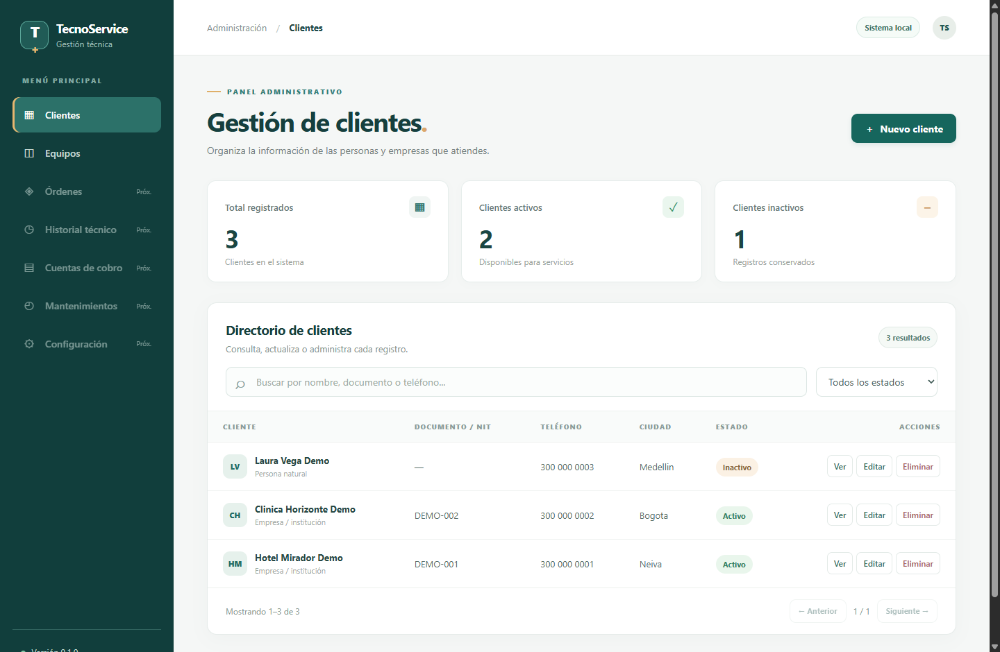
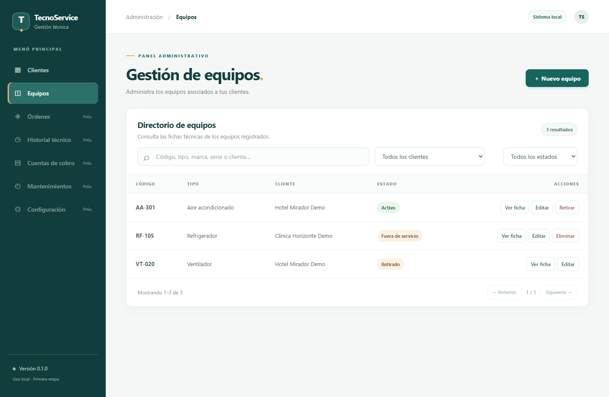
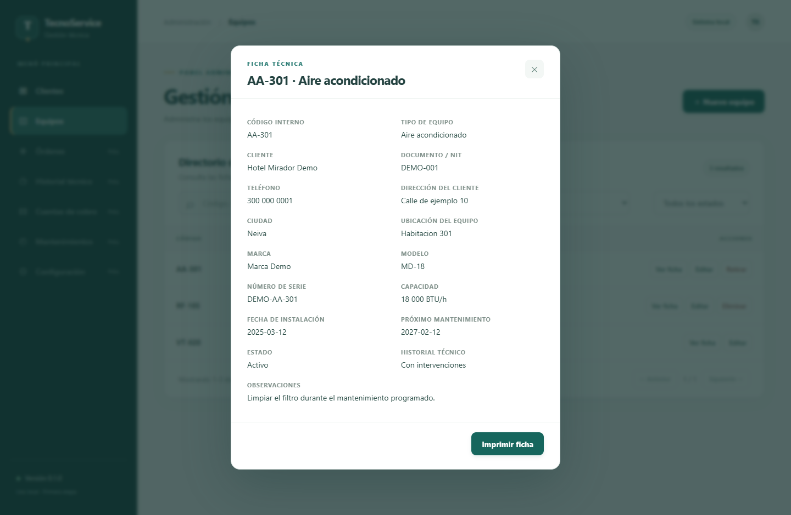

# TecnoService · Fase 2

Aplicación administrativa local orientada a servicios técnicos con módulos de Clientes y Equipos.

## Tecnologías utilizadas

| Tecnología | Uso en TecnoService |
|---|---|
| HTML y CSS | Pantallas, diseño adaptable y ficha técnica imprimible |
| JavaScript | Formularios, búsqueda y comunicación con la API desde el navegador |
| Node.js | Ejecución del servidor local y de las pruebas |
| Express | API REST y servidor de archivos estáticos |
| SQLite | Almacenamiento de clientes y equipos mediante `node:sqlite` |

## 1. Requisitos

- Node.js **22.13 o superior**. El proyecto usa `node:sqlite` nativo (experimental en la rama 22); no precisa `sqlite3`, `better-sqlite3` ni ORM.
- npm incluido con Node.
- Navegador actualizado (Chrome, Edge, Firefox).

## 2. Instalar y ejecutar (Windows / PowerShell)

Abre la carpeta `TecnoService` desde VS Code y, en la terminal:

```powershell
git clone https://github.com/David-Kim-123/TecnoService.git
cd TecnoService
node -v
npm ci
npm start
```

Abre **http://127.0.0.1:3000** en tu navegador. Para desarrollo con recarga al modificar el servidor:

```powershell
npm run dev
```

En Linux o macOS, ejecuta los mismos comandos desde una terminal.

**Dependencia npm:** solo `express` (API REST, servidor de archivos HTML y análisis JSON). Las operaciones SQLite se realizan con la API incorporada en Node.js. Si tu versión de Node indica que SQLite sigue siendo experimental, la advertencia es esperada.

La base de datos se crea automáticamente en `data/tecnoservice.sqlite` al iniciar la aplicación. La carpeta `data/` está excluida de Git.

## Capturas de pantalla

Capturas de la aplicación en ejecución con datos ficticios.

| Clientes | Equipos |
|---|---|
|  |  |

<details>
<summary>Ficha técnica de un equipo</summary>



</details>

## 3. Qué funciona ahora

- Registrar cliente persona natural o empresa.
- Ver directorio y ficha detallada.
- Buscar por nombre, documento o teléfono.
- Filtrar activos e inactivos, paginar de 20 en 20.
- Editar todos los campos.
- Eliminar físicamente clientes sin referencias; desactivar clientes con registros relacionados.
- Rechazar documentos duplicados.
- Validar entradas en frontend y backend.
- Consultas SQL parametrizadas, clave foránea activa, integridad y persistencia SQLite.
- Interfaz adaptable a escritorio y móvil.

- Registrar y editar equipos asociados a clientes existentes.
- Buscar equipos por código, tipo, marca, modelo, serie, ubicación o nombre del cliente. Filtrar por cliente y estado.
- Imprimir la ficha técnica o guardarla como PDF desde el diálogo del navegador.
- Eliminar equipos sin intervenciones y retirar equipos con intervenciones. Los equipos retirados y su historial se conservan.

El registro de intervenciones, las órdenes, las cuentas de cobro y las alertas corresponden a fases posteriores.

## 4. API disponible

| Método | Ruta | Uso |
|---|---|---|
| GET | `/api/salud` | Estado del servidor |
| GET | `/api/clientes` | Listar / buscar / filtrar |
| GET | `/api/clientes/resumen` | Conteos activos e inactivos |
| GET | `/api/clientes/:id` | Detalle |
| POST | `/api/clientes` | Crear |
| PUT | `/api/clientes/:id` | Editar |
| DELETE | `/api/clientes/:id` | Eliminar o desactivar |
| GET | `/api/equipos` | Listar, buscar y filtrar |
| GET | `/api/equipos/opciones-clientes` | Clientes disponibles para asociar y filtrar |
| GET | `/api/equipos/:id` | Consultar ficha técnica y vínculo con historial |
| POST | `/api/equipos` | Crear |
| PUT | `/api/equipos/:id` | Editar |
| DELETE | `/api/equipos/:id` | Eliminar equipo sin intervenciones |
| PATCH | `/api/equipos/:id/retirar` | Retirar equipo con intervenciones |

Listado: `GET /api/clientes?buscar=hotel&estado=activos&pagina=1`.

Ejemplo JSON para `POST /api/clientes`:

```json
{
  "tipo": "empresa",
  "nombre": "Hotel Ejemplo",
  "documento": "900123456-7",
  "telefono": "3001234567",
  "correo": "contacto@hotel.com",
  "direccion": "Calle 10 # 5-20",
  "ciudad": "Neiva",
  "observaciones": "Cliente institucional"
}
```

## 5. Pruebas automáticas

Con las dependencias instaladas:

```powershell
npm test
```

`test/clientes.test.js` verifica CRUD, errores de validación, protección ante documentos duplicados, búsqueda parametrizada, integridad referencial, preservación de historial, persistencia después de reabrir SQLite y la restricción de cobro vigente único (solo a nivel de esquema).

`test/api.test.js` verifica endpoints HTTP reales cuando Express está instalado. Si no está disponible, el test HTTP se declara **omitido**, no aprobado.

### Prueba manual inicial (prioritaria)

1. `npm start` y abre `http://127.0.0.1:3000`.
2. Haz clic en **Nuevo cliente** y registra "Hotel Ejemplo".
3. Confirma que aparece en la tabla y en el resumen de activos.
4. Busca "Hotel" y abre **Ver**.
5. Abre **Editar**, cambia el teléfono y guarda.
6. Reinicia el servidor con Ctrl+C y `npm start`.
7. Comprueba que el teléfono modificado persiste.
8. Elimina el cliente si no tiene registros relacionados; desaparece del listado.

La prueba integral del hotel con tres equipos y cuenta por **$280.000 COP** se ejecutará cuando estén implementados los módulos siguientes; no se presenta como superada en esta entrega.

## 6. Seguridad, límites y respaldos

- El servidor escucha solo en `127.0.0.1`; **no expongas esta versión a Internet ni a una red local**.
- No hay autenticación ni roles todavía.
- Los valores enviados a SQL se parametrizan.
- La UI incorpora datos mediante `textContent` para evitar interpretar HTML procedente de clientes.
- Haz copias de seguridad del archivo `data/tecnoservice.sqlite` cuando la app esté detenida. No lo publiques en GitHub ni compartas datos reales.
- Para cambiar la base de datos de una versión futura habrá que implementar migraciones explícitas.

## 7. Verificación de Equipos

1. Abre **Equipos** desde el menú o **Ver equipos** desde la ficha de un cliente.
2. Pulsa **Nuevo equipo**, elige un cliente y completa código interno, tipo y ubicación.
3. Busca por código, abre **Ver ficha** y pulsa **Imprimir ficha** para revisar la vista previa.
4. Edita la ubicación, guarda y recarga para verificar el cambio. Usa **Eliminar** con el equipo de prueba.
5. Si la base ya tiene un equipo con intervenciones, usa **Retirar** y verifícalo con el filtro **Retirado**. Si la base aún está vacía de intervenciones, `test/equipos.test.js` verifica el retiro y la conservación del historial con SQLite en memoria.

Consulta `docs/analisis-tecnico.md` para el modelo relacional, las reglas y riesgos.

## Prompts utilizados

Estos son los prompts de la conversación sobre la Fase 2 y su entrega.

1. **Implementación de la Fase 2**

   > Analiza el proyecto TecnoService ubicado en el directorio actual. Implementa la Fase 2: CRUD de equipos asociados a los clientes existentes. Debe permitir crear, consultar, buscar, editar, eliminar equipos sin historial y retirar equipos con historial, además de imprimir su ficha técnica. Conserva el módulo de Clientes, su información y el diseño visual actual. Antes de cualquier cambio, respalda la base de datos SQLite existente. No reconstruyas el proyecto ni borres registros. Utiliza el stack actual: HTML, CSS, JavaScript, Node.js, Express y SQLite. Al finalizar, ejecuta las pruebas disponibles, informa los archivos modificados y explica cómo verificar el funcionamiento. No implementes todavía órdenes ni cuentas de cobro.

   **Qué pedí y para qué.** Ampliar el proyecto con la gestión de equipos, conservar los datos y la interfaz de Clientes, y verificar que la aplicación siguiera funcionando. El respaldo previo protegía la base de datos durante el cambio.

2. **Publicación del código**

   > LISTO TODO SIRVIO PUEDES SUBIR LOS CAMBIOS

   **Qué pedí y para qué.** Después de verificar el funcionamiento, solicité publicar el código en GitHub. En el mensaje siguiente indiqué el repositorio de destino, `David-Kim-123/TecnoService`.

3. **Documentación de la entrega**

   > 2. Repositorio de GitHub
   >
   > Un repositorio con todo el código fuente y un archivo README.md que incluya:
   >
   > - Nombre del proyecto
   > - Descripción breve
   > - Tecnologías utilizadas (por ejemplo, HTML, CSS, JavaScript, Node.js, React)
   > - Instrucciones para ejecutar el proyecto
   > - Capturas de pantalla
   > - Lista de los prompts que usaste, cada uno con su explicación (qué pediste y para qué)

   **Qué pedí y para qué.** Documentar la entrega para que otra persona pueda conocer la aplicación, ejecutarla, ver sus pantallas y entender qué se solicitó durante el desarrollo.
